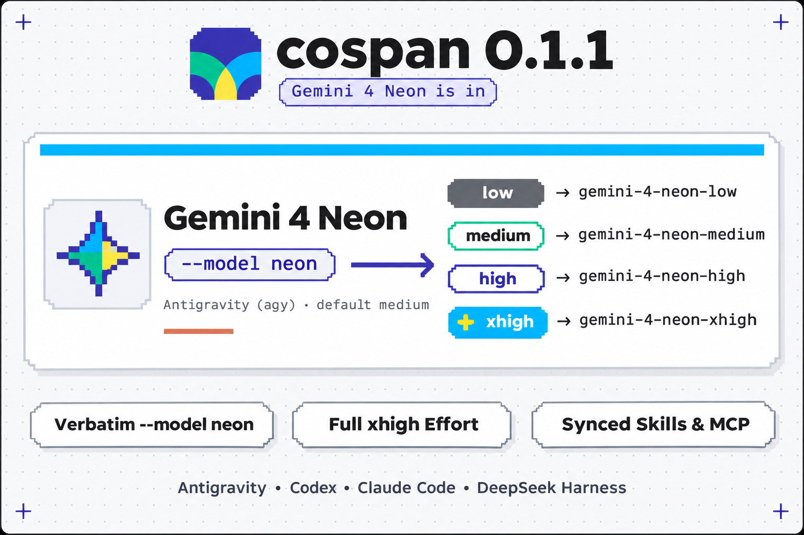

# cospan 0.1.1 — Gemini 4 Neon is in

_Header illustration generated via [`cospan-codex`](../../skills/codex/SKILL.md)._

## Highlights

`cospan` **0.1.1** brings first-class **Gemini 4 Neon** support to the Antigravity (`agy`) harness—keeping existing `agy` defaults (`gemini-3.8-flash-medium`) intact while enabling clean `neon` shortcut and full reasoning effort resolution across all hosts.

### What's New

- **Gemini 4 Neon shortcut & effort family (`src/config.mjs`, `src/drivers/agy-protocol.mjs`)**:
  - Added `neon` and `gemini-4-neon` built-in mappings for `agy`, defaulting to `gemini-4-neon-medium` consistent with the rest of the `agy` model family.
  - Registered `gemini-4-neon` in `EFFORT_FAMILIES` and `XHIGH_EFFORT_FAMILIES` so `--effort low|medium|high|xhigh` (and `max -> xhigh`) resolves deterministically to `gemini-4-neon-{low,medium,high,xhigh}` on both fresh dispatches and `continue` turns.
- **Synced host skills, MCP schema, and docs (`src/installer-templates.mjs`, `src/mcp/tools.mjs`, `skills/agy/SKILL.md`, `README.md`, `README.zh-CN.md`)**:
  - Updated the verbatim model shortcut contract and `xhigh` effort notes across `cospan-agy` / `$cospan:agy` skills, `cospan_*` MCP parameter descriptions, and README harness tables.

## Validation

- `npm run lint`
- `npm run format:check`
- `npm test`
- `node bin/cospan.mjs install`
- `node bin/cospan.mjs doctor --check`

## Install & Upgrade

See [README.md](../../README.md#install) and [docs/INSTALL_FOR_AGENTS.md](../INSTALL_FOR_AGENTS.md).
