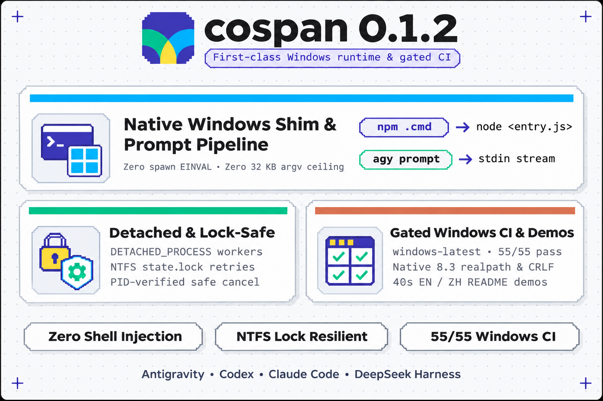

# cospan 0.1.2 — First-class Windows runtime & gated CI



_Header illustration generated via [`cospan-codex`](../../skills/codex/SKILL.md)._

## Highlights

`cospan` **0.1.2** delivers first-class **Windows runtime and plugin support** across Antigravity (`agy`), OpenAI Codex (`codex`), Claude Code (`claude`), and DeepSeek Harness (`dsh`), backed by a real-OS gated **`windows-latest` CI suite** and bilingual 40-second walkthrough demos in the README.

### What's New

- **Native `.cmd` shim unwrapping & Windows binary discovery (`src/targets.mjs`, `src/contract-check.mjs`, `src/commands/*`, `src/drivers/*`, `dsh/index.mjs`)**:
  - Unwraps npm-generated `.cmd` shims directly to `node <entry.js>`—eliminating Node `CVE-2024-27980` `spawn EINVAL` errors and `cmd.exe` `%VAR%` / `&` / `|` / multiline prompt corruption—with safe `ComSpec /d /s /c` quoting fallback for non-Node batch wrappers and `windowsHide: true` across every child spawn site.
  - Evaluates `%USERPROFILE%`, `%APPDATA%\npm`, and `%LOCALAPPDATA%\Programs\Antigravity\bin` dynamically with `.exe` / `.cmd` / `.bat` resolution during target discovery.
- **Stdin prompt transport for Antigravity (`src/drivers/agy.mjs`)**:
  - Streams `agy` prompts over `stdin` instead of `-p <prompt>` argv, removing the Windows `CreateProcessW` 32,767-character `ENAMETOOLONG` ceiling on large context envelopes while keeping prompts out of process-table listings across all OSes.
- **Detached worker survival, NTFS `state.lock` hardening, and stream-worker timing (`src/job-worker.mjs`, `src/state-lock.mjs`, `src/job-store.mjs`, `src/stream-worker.mjs`, `src/commands/lifecycle.mjs`, `src/sidebar-state.mjs`)**:
  - Spawns detached `_worker` processes with `detached: true` on Windows (`DETACHED_PROCESS`) and moves `processIdentity()` out of parent dispatch and `state.lock` critical sections so jobs register immediately and survive parent CLI exit.
  - Protects `~/.cospan/trajectories/<ws>/state.json` with cross-process `state.lock` acquisition, bounded `EBUSY` / `EPERM` / `EACCES` retry loops for NTFS `FileShare.None` handles, and non-destructive `loadState()` error propagation so transient locks never wipe active jobs.
  - Attaches child `stdout` / `stderr` listeners immediately on spawn and starts timeout budgets after initial process-tree snapshotting.
- **Gated Windows CI, 8.3 short-path / CRLF safety, and README walkthrough videos (`.github/workflows/ci.yml`, `.gitattributes`, `src/config.mjs`, `src/repo-family.mjs`, `src/ui/sync-dsh-client.mjs`, `README.md`, `README.zh-CN.md`)**:
  - Added environment-gated `Tests (Windows)` on `windows-latest` (`55/55` tests passing), `.gitattributes` LF normalization, `fs.realpathSync.native` Windows 8.3 short-path canonicalization (`RUNNER~1`), CRLF-resilient DSH client bundle syncing, and 40s English & Simplified Chinese demo videos.

## Validation

- `npm run lint`
- `npm run format:check`
- `npm test` (55/55 passing across `windows-latest`, `ubuntu-latest`, and `macos-latest`)
- `node bin/cospan.mjs install`
- `node bin/cospan.mjs doctor --check`

## Upgrade

> [!TIP]
> **Recommended — For coding agents:** Paste this into any coding agent to upgrade Cospan to `v0.1.2` and verify CLI contracts for your current harness automatically:
>
> ```text
> Read the raw text of https://raw.githubusercontent.com/keli-wen/cospan/master/docs/INSTALL_FOR_AGENTS.md
> (curl it — do not work from a summary) and follow it to upgrade Cospan to v0.1.2 and verify it for the harness you are running in.
> Respond in the user's language.
> ```

<details>
<summary>Manual upgrade commands (agy / claude / codex / dsh)</summary>

- **Antigravity (`agy`)**: `git -C ~/.cospan/repo pull --ff-only && node ~/.cospan/repo/bin/cospan.mjs install --host agy`
- **Claude Code (`claude`)**: `claude plugin marketplace update cospan && claude plugin update cospan@cospan`
- **OpenAI Codex (`codex`)**: `codex plugin marketplace upgrade && codex plugin add cospan@cospan`
- **DeepSeek Harness (`dsh`)**: `dsh plugin --profile desktop add 'github:keli-wen/cospan#v0.1.2'`

Restart Claude Code or Codex after upgrading, then run `node <cospan-root>/bin/cospan.mjs doctor --check` (zero tokens). For first-time setup, Windows notes, or cache refreshes, see [README.md](../../README.md#install) and [docs/INSTALL_FOR_AGENTS.md](../INSTALL_FOR_AGENTS.md).

</details>
