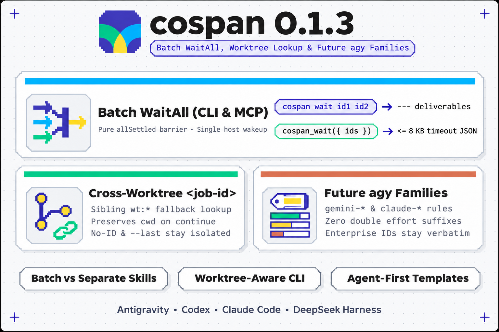

# cospan 0.1.3 — Batch WaitAll, Cross-Worktree Lookup & Future `agy` Model Families



_Header illustration generated via [`cospan-codex`](../../skills/codex/SKILL.md)._

## Highlights

`cospan` **0.1.3** makes parallel multi-agent workflows and linked Git worktrees work seamlessly end-to-end: collect multiple concurrent jobs in a single **WaitAll** barrier across CLI and MCP, address sibling worktree jobs directly by `<job-id>` from the main repository, use future versioned Gemini and Claude models on `agy` with `--effort` immediately, and contribute via new agent-first issue/PR templates.

### What's New

- **Batch `WaitAll` across CLI, MCP, and host skills (#10, #13)**:
  - `cospan wait <id1> <id2> ... [--timeout <dur>]` and MCP `cospan_wait({ cwd, ids: [...] })` now support pure `allSettled` batch waiting: all listed jobs run to completion without canceling siblings on early failure, deliverables render in caller-specified order separated by `\n---\n\n`, and exit codes follow highest-severity precedence (`3` error/crashed > `4` canceled > `5` attention > `0` all done).
  - Deduplicates repeated IDs, fails fast on unknown IDs, and keeps 0-arg / 1-arg `cospan wait` 100% backwards-compatible.
  - On `--timeout` while any job is still running, prints a bounded (`<= 8 KiB`) JSON summary (`status: "running"`, `completed_ids`, `pending_ids`, per-job `status`) with exit code `2` without dumping completed bodies yet—preventing duplicate context on subsequent `wait` calls.
  - Updated all generated host skill templates (`agy`, `codex`, `claude`, `dsh`, `jobs`) to spell out when to batch `wait` (next step needs all parallel outputs together) vs. issue separate `wait` calls (uneven runtimes where acting on the first completion matters).
- **Cross-worktree explicit `<job-id>` CLI resolution (#9, #12)**:
  - CLI and MCP commands passed an explicit `<job-id>` (`observe`, `status <id>`, `result`, `wait`, `cancel`, `continue --id`, `restart`, and batch `wait`) now fall back across sibling Git worktrees in the same repository family—matching the jobs surfaced in the unified sidebar (`wt:*`).
  - `continue --id` and `restart` preserve the original worktree working directory (`cwd`) and fail cleanly if a removed worktree directory no longer exists, while read-only lookups (`observe`, `result`, `status <id>`) continue working after worktree removal via the repo index.
  - All no-ID commands (`status`, `wait`, `result`, `observe`, `continue --last`) remain strictly isolated to the current worktree so `--last` never crosses branches.
- **Generalized Gemini & Claude effort resolution for `agy` (#11, #14)**:
  - Extended `agy` model-family detection beyond its hardcoded 10-entry allowlist to recognize future versioned `gemini-<digit>*` and `claude-(opus|sonnet|haiku)-*` model IDs automatically.
  - Checks existing `-(low|medium|high|xhigh)` suffixes before family matching so already-suffixed models never get double-suffixed, while explicit `--effort` cleanly overrides the suffix.
  - Preserves known-family clamping (`gemini-4-carbon`, `claude-opus-5-5`, etc. clamp `xhigh -> high`; `gemini-4-neon`, `gemini-4-hydrogen`, and unknown future `gemini-\d*` families allow `xhigh`) and verbatim passthrough for custom/enterprise non-family models.
- **Agent-first contributor docs & human-first PR template (#8, #15)**:
  - Added `CONTRIBUTING.md` with the change-surface verification matrix and offline `tests/fakes/*` policy, structured GitHub Issue Forms, and a human-first PR template emphasizing plain-language `TL;DR` + `Before → After` examples instead of diff narration.

## Validation

- `npm run lint`
- `npm run format:check`
- `npm test` (63 offline tests: 57 passing on macOS/Linux with 6 `win32`-only skipped; `windows-latest` CI verifies full Windows matrix)
- `node bin/cospan.mjs install`
- `node bin/cospan.mjs doctor --check`

## Upgrade

> [!TIP]
> **Recommended — For coding agents:** Paste this into any coding agent to upgrade Cospan to `v0.1.3` and verify CLI contracts for your current harness automatically:
>
> ```text
> Read the raw text of https://raw.githubusercontent.com/keli-wen/cospan/master/docs/INSTALL_FOR_AGENTS.md
> (curl it — do not work from a summary) and follow it to upgrade Cospan to v0.1.3 and verify it for the harness you are running in.
> Respond in the user's language.
> ```

<details>
<summary>Manual upgrade commands (agy / claude / codex / dsh)</summary>

- **Antigravity (`agy`)**: `git -C ~/.cospan/repo pull --ff-only && node ~/.cospan/repo/bin/cospan.mjs install --host agy`
- **Claude Code (`claude`)**: `claude plugin marketplace update cospan && claude plugin update cospan@cospan`
- **OpenAI Codex (`codex`)**: `codex plugin marketplace upgrade && codex plugin add cospan@cospan`
- **DeepSeek Harness (`dsh`)**: `dsh plugin --profile desktop add 'github:keli-wen/cospan#v0.1.3'`

Restart Claude Code or Codex after upgrading, then run `node <cospan-root>/bin/cospan.mjs doctor --check` (zero tokens). For first-time setup, Windows notes, or cache refreshes, see [README.md](../../README.md#install) and [docs/INSTALL_FOR_AGENTS.md](../INSTALL_FOR_AGENTS.md).

</details>
